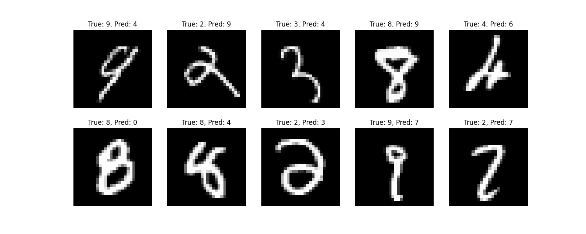

# CNN from scratch in NumPy

[](https://www.python.org/)
[](https://numpy.org/)

A convolutional network written in NumPy alone, with the forward pass, backpropagation through every layer type and SGD with momentum all coded by hand. It reaches **90.94% test accuracy on MNIST** after 5 epochs on 5,000 training images.


## Results

| Metric | Value |
|---|---:|
| Test accuracy | 90.94% |
| Train accuracy | 93.97% |
| Test loss | 0.2861 |
| Training samples | 5,000 |
| Test samples | 1,000 |
| Epochs | 5 |

### Check against PyTorch

[`compare_implementations.py`](../pytorch_cnn/compare_implementations.py) rebuilds the same architecture in PyTorch and trains both on the same data.

| Metric | NumPy | PyTorch | Difference |
|---|---:|---:|---:|
| Train accuracy | 93.63% | 93.64% | 0.01 points |
| Test accuracy | 91.25% | 93.00% | 1.75 points |

Training accuracy agrees to 0.01 points, which is consistent with the hand-written gradients matching autograd. The two runs use different random initialisation and batch order, so the 1.75-point test difference is within what those would produce. This comparison is a separate run from the headline result, which is why its NumPy test accuracy reads 91.25% and the table above reads 90.94%.

### Training dynamics

- Train loss falls from 1.71 to 0.25 over the 5 epochs with no oscillation.
- The gap between train and test accuracy stays near 3 points.
- Test loss sits below train loss in the first epochs. Train loss is averaged over every mini-batch in the epoch, including the early ones, while test loss is measured once on the weights at the end of the epoch.

### Per-class accuracy

| Digit | Accuracy | Most frequent confusion |
|---|---:|---|
| 0 | 94.12% | |
| 1 | 94.44% | |
| 2 | 90.52% | 7 |
| 3 | 88.79% | 8 |
| 4 | 95.45% (highest) | |
| 5 | 83.91% (lowest) | 6 |
| 6 | 90.80% | 0 |
| 7 | 91.92% | 1 |
| 8 | 92.13% | 3 |
| 9 | 85.11% | 4 |

### Error analysis



The errors concentrate on digit pairs that share strokes, such as 4 and 6, 7 and 9, and 3 and 8. Most of the misclassified images are ambiguous to a human reader as well.

## Architecture

```
Input (batch, 1, 28, 28)
         │
  Conv2D(1→8, 3×3, pad=1)
  ReLU
  MaxPool2D(2×2)               → (batch, 8, 14, 14)
         │
  Conv2D(8→16, 3×3, pad=1)
  ReLU
  MaxPool2D(2×2)               → (batch, 16, 7, 7)
         │
  Flatten                      → (batch, 784)
  Dense(784 → 128)
  ReLU
  Dense(128 → 10)
  Softmax                      → (batch, 10) class probabilities
```

The network has about 103,000 parameters, most of them in the dense layers.

## Implementation

Each layer in `layers.py` implements three methods. `forward(input)` computes the output and caches the input, `backward(grad_output)` applies the chain rule and returns the gradient for the previous layer, and `get_params()` hands `(parameter, gradient)` pairs to the optimiser.

| Layer | Forward | Backward |
|---|---|---|
| `Conv2D` | Sliding-window convolution | ∂L/∂W from input patches, ∂L/∂x from transposed weights |
| `MaxPool2D` | Max over 2×2 windows | Whole gradient to the max position, zero elsewhere |
| `Dense` | xW + b | ∂L/∂W = xᵀ @ grad, ∂L/∂x = grad @ Wᵀ |
| `ReLU` | max(0, x) | grad × (input > 0) |
| `Softmax` | eˣ / Σeˣ | Full Jacobian |
| `Flatten` | Reshape to 1D | Reshape to the original dimensions |

```python
# Dense layer backward
def backward(self, grad_output: np.ndarray) -> np.ndarray:
    self.grad_weights = self.input.T @ grad_output    # ∂L/∂W
    self.grad_bias    = grad_output.sum(axis=0)       # ∂L/∂b
    return grad_output @ self.weights.T               # ∂L/∂x, passed to the previous layer

# ReLU backward
def backward(self, grad_output: np.ndarray) -> np.ndarray:
    return grad_output * (self.input > 0)
```

Weights use He initialisation, `std = sqrt(2 / fan_in)`, which keeps gradient variance stable through ReLU layers. The optimiser in `train.py` is SGD with momentum 0.9.

```python
velocity  = momentum * velocity - learning_rate * gradient
parameter += velocity
```

## Validation order

The network was first trained on a synthetic task before it saw MNIST, so that gradient bugs would show up on data where the right answer is obvious. The task has 600 training and 150 test images of 14×14 pixels in three classes (vertical, horizontal and diagonal lines).

```
Epoch 1:   Train 47.74%, Test 90.62%
Epoch 2:   Train 99.65%, Test 100.00%
Epoch 3+:  Train 100%,   Test 100.00%
```

MNIST training followed only after this passed.

## Usage

```bash
# TensorFlow is used only to download MNIST
pip install numpy tensorflow

python test_mnist.py        # synthetic line patterns
python test_real_mnist.py   # MNIST training and evaluation
```

Log of the comparison run:

```
Epoch 1/5 - Train Loss: 1.7076, Train Acc: 0.4521, Test Loss: 0.9539, Test Acc: 0.7156
Epoch 2/5 - Train Loss: 0.5711, Train Acc: 0.8347, Test Loss: 0.5387, Test Acc: 0.8198
Epoch 3/5 - Train Loss: 0.3688, Train Acc: 0.8942, Test Loss: 0.3987, Test Acc: 0.8802
Epoch 4/5 - Train Loss: 0.2931, Train Acc: 0.9183, Test Loss: 0.3411, Test Acc: 0.8990
Epoch 5/5 - Train Loss: 0.2507, Train Acc: 0.9363, Test Loss: 0.2861, Test Acc: 0.9125
```

## Files

| File | Contents |
|---|---|
| `layers.py` | Every layer with its forward and backward pass |
| `network.py` | `Network` class and `CrossEntropyLoss` |
| `train.py` | SGD with momentum and the training loop |
| `test_mnist.py` | Synthetic pattern validation |
| `test_real_mnist.py` | MNIST training and evaluation |
| `cnn_scratch_test.py` | Unit tests for the training loop |

## References

- Rumelhart, D. E., Hinton, G. E., & Williams, R. J. (1986). *Learning representations by back-propagating errors.* Nature, 323(6088), 533-536.
- He, K., Zhang, X., Ren, S., & Sun, J. (2015). *Delving Deep into Rectifiers: Surpassing Human-Level Performance on ImageNet Classification.* ICCV 2015, pp. 1026-1034. [arXiv:1502.01852](https://arxiv.org/abs/1502.01852)
- LeCun, Y., Bottou, L., Bengio, Y., & Haffner, P. (1998). *Gradient-based learning applied to document recognition.* Proceedings of the IEEE, 86(11), 2278-2324.

Part of the [applied-ml portfolio](../../../README.md).
