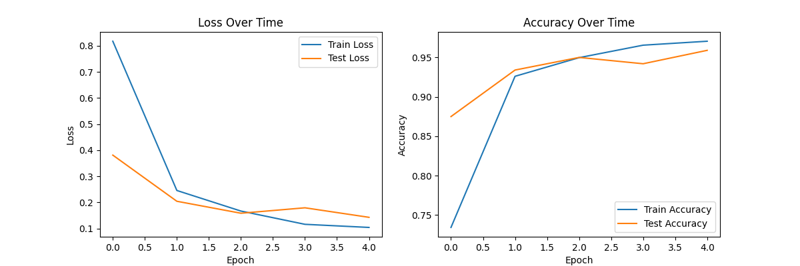

# CNN from scratch in NumPy

[](https://www.python.org/)
[](https://numpy.org/)

A convolutional network written in NumPy alone, with the forward pass, backpropagation through every layer type and SGD with momentum all coded by hand. It reaches **95.90% test accuracy on MNIST** after 5 epochs on 5,000 training images, scored on 1,000 test images, and every gradient it computes is checked against finite differences.



> [!NOTE]
> Corrected in November 2026. Earlier versions passed the cross-entropy gradient through the softmax Jacobian a second time, scored only 960 of the 1,000 test images and reported 90.94%. Both faults are fixed, every figure on this page comes from the corrected code, and the gradient checks below fail if the doubled Jacobian returns.

## Results

| Metric | Value |
|---|---:|
| Test accuracy | 95.90% |
| Train accuracy, final epoch | 97.06% |
| Test loss | 0.1428 |
| Training samples | 5,000 |
| Test samples | 1,000 |
| Epochs | 5 |
| Seed | 42 |

Every figure here is read from [`results.json`](results.json), which `test_real_mnist.py` writes at the end of each run.

### Gradient checks

[`test_gradcheck.py`](../tests/test_gradcheck.py) compares each analytical gradient with a central-difference estimate in float64, with a step of 1e-6, and fails when the relative error reaches 1e-6. It runs with the foundations test suite, 8 checks in all.

| Check | What is differentiated |
|---|---|
| `Conv2D`, padding 1 and stride 1, then padding 0 and stride 2 | Input, weights and bias |
| `MaxPool2D` | Input |
| `Dense` | Input, weights and bias |
| `ReLU`, `Softmax` | Input |
| Softmax followed by cross-entropy | Logits, which must equal (p − y) / batch |
| Conv, ReLU, pool, dense and softmax under cross-entropy | Every parameter of the network |

### Check against PyTorch

[`compare_implementations.py`](../pytorch_cnn/compare_implementations.py) trains the same architecture in PyTorch on the same data and writes [`comparison_results.json`](../pytorch_cnn/comparison_results.json).

| Metric | NumPy | PyTorch | Difference |
|---|---:|---:|---:|
| Train accuracy | 97.06% | 93.64% | 3.42 points |
| Test accuracy | 95.90% | 93.00% | 2.90 points |
| Train loss | 0.1041 | 0.2122 | 0.1082 |
| Test loss | 0.1428 | 0.2101 | 0.0674 |

The two frameworks draw their initial weights from different random number generators, so this compares two training runs of one architecture. The gradient checks above are the exact test. The NumPy side reproduces the headline run above exactly, since both use seed 42.

### Training dynamics

- Train loss falls from 0.82 to 0.10 over the 5 epochs, lower at every epoch.
- At the final epoch, train accuracy is 1.2 points above test accuracy.
- Test loss starts below train loss. Train loss is averaged over every mini-batch in the epoch, including the early ones, while test loss is measured once on the weights at the end of the epoch.

### Per-class accuracy

| Digit | Accuracy | Most frequent wrong prediction (count) |
|---|---:|---|
| 0 | 98.82% | 6 (1) |
| 1 | 100.00% (highest) | none |
| 2 | 89.66% | 8 (3) |
| 3 | 98.13% | 8 (1) |
| 4 | 98.18% | 9 (1) |
| 5 | 96.55% | 9 (1) |
| 6 | 97.70% | 0 (2) |
| 7 | 94.95% | 9 (2) |
| 8 | 86.52% (lowest) | 9 (3) |
| 9 | 97.87% | 7 (1) |

### Error analysis


The network gets 41 of the 1,000 test images wrong. The most frequent confusions are 8 read as 9 (3), 8 read as 0 (3), 2 read as 8 (3), read from the confusion matrix in `results.json`.

## Architecture

```
Input (batch, 1, 28, 28)
         │
  Conv2D(1→8, 3×3, pad=1)
  ReLU
  MaxPool2D(2×2)               → (batch, 8, 14, 14)
         │
  Conv2D(8→16, 3×3, pad=1)
  ReLU
  MaxPool2D(2×2)               → (batch, 16, 7, 7)
         │
  Flatten                      → (batch, 784)
  Dense(784 → 128)
  ReLU
  Dense(128 → 10)
  Softmax                      → (batch, 10) class probabilities
```

The network has about 103,000 parameters, most of them in the dense layers.

## Implementation

Each layer in `layers.py` implements three methods. `forward(input)` computes the output and caches the input, `backward(grad_output)` applies the chain rule and returns the gradient for the previous layer, and `get_params()` hands `(parameter, gradient)` pairs to the optimiser.

| Layer | Forward | Backward |
|---|---|---|
| `Conv2D` | Sliding-window convolution | ∂L/∂W from input patches, ∂L/∂x from transposed weights |
| `MaxPool2D` | Max over 2×2 windows | Whole gradient to the max position, zero elsewhere |
| `Dense` | xW + b | ∂L/∂W = xᵀ @ grad, ∂L/∂x = grad @ Wᵀ |
| `ReLU` | max(0, x) | grad × (input > 0) |
| `Softmax` | eˣ / Σeˣ | Full Jacobian |
| `Flatten` | Reshape to 1D | Reshape to the original dimensions |

`CrossEntropyLoss.backward()` in `network.py` returns the gradient with respect to the probabilities, −y / p / batch. The `Softmax` layer's backward pass turns that into (p − y) / batch for the logits, so the Jacobian is applied exactly once.

```python
# Dense layer backward
def backward(self, grad_output: np.ndarray) -> np.ndarray:
    self.grad_weights = self.input.T @ grad_output    # ∂L/∂W
    self.grad_bias    = grad_output.sum(axis=0)       # ∂L/∂b
    return grad_output @ self.weights.T               # ∂L/∂x, passed to the previous layer
```

Weights use He initialisation, `std = sqrt(2 / fan_in)`, which keeps gradient variance stable through ReLU layers. The optimiser in `train.py` is SGD with momentum 0.9. Training drops the last partial batch of each shuffled epoch, and evaluation scores every test image.

## Validation order

Before MNIST, the network is trained on a synthetic task where the right answer is obvious, 600 training and 150 test images of 14×14 pixels in three classes (vertical, horizontal and diagonal lines). `test_mnist.py` gives:

```
Epoch  1: Train  72.74%, Test 100.00%
Epoch  2: Train 100.00%, Test 100.00%
Epoch  3: Train 100.00%, Test 100.00%
Epoch  4: Train 100.00%, Test 100.00%
Epoch  5: Train 100.00%, Test 100.00%
Epoch  6: Train 100.00%, Test 100.00%
Epoch  7: Train 100.00%, Test 100.00%
Epoch  8: Train 100.00%, Test 100.00%
Epoch  9: Train 100.00%, Test 100.00%
Epoch 10: Train 100.00%, Test 100.00%
```

## Usage

```bash
# TensorFlow is used only to download MNIST
pip install numpy tensorflow

python test_mnist.py        # synthetic line patterns
python test_real_mnist.py   # MNIST training and evaluation, writes results.json
python -m pytest ../tests/test_gradcheck.py -v
```

Log of the run reported above:

```
Epoch 1/5 - Train Loss: 0.8175, Train Acc: 0.7344, Test Loss: 0.3811, Test Acc: 0.8750
Epoch 2/5 - Train Loss: 0.2456, Train Acc: 0.9261, Test Loss: 0.2043, Test Acc: 0.9340
Epoch 3/5 - Train Loss: 0.1668, Train Acc: 0.9497, Test Loss: 0.1585, Test Acc: 0.9500
Epoch 4/5 - Train Loss: 0.1160, Train Acc: 0.9655, Test Loss: 0.1793, Test Acc: 0.9420
Epoch 5/5 - Train Loss: 0.1041, Train Acc: 0.9706, Test Loss: 0.1428, Test Acc: 0.9590
```

## Files

| File | Contents |
|---|---|
| `layers.py` | Every layer with its forward and backward pass |
| `network.py` | `Network` class and `CrossEntropyLoss` |
| `train.py` | SGD with momentum, the training loop and evaluation |
| `test_mnist.py` | Synthetic pattern validation |
| `test_real_mnist.py` | MNIST training and evaluation |
| `results.json` | History, per-class accuracy and confusion matrix of the reported run |
| `cnn_scratch_test.py` | Unit tests for the training loop |
| [`../tests/test_gradcheck.py`](../tests/test_gradcheck.py) | Finite-difference gradient checks |

## References

- Rumelhart, D. E., Hinton, G. E., & Williams, R. J. (1986). *Learning representations by back-propagating errors.* Nature, 323(6088), 533-536.
- He, K., Zhang, X., Ren, S., & Sun, J. (2015). *Delving Deep into Rectifiers: Surpassing Human-Level Performance on ImageNet Classification.* ICCV 2015, pp. 1026-1034. [arXiv:1502.01852](https://arxiv.org/abs/1502.01852)
- LeCun, Y., Bottou, L., Bengio, Y., & Haffner, P. (1998). *Gradient-based learning applied to document recognition.* Proceedings of the IEEE, 86(11), 2278-2324.

Part of the [applied-ml portfolio](../../../README.md).
